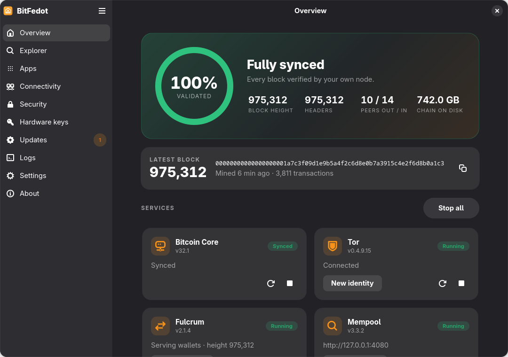
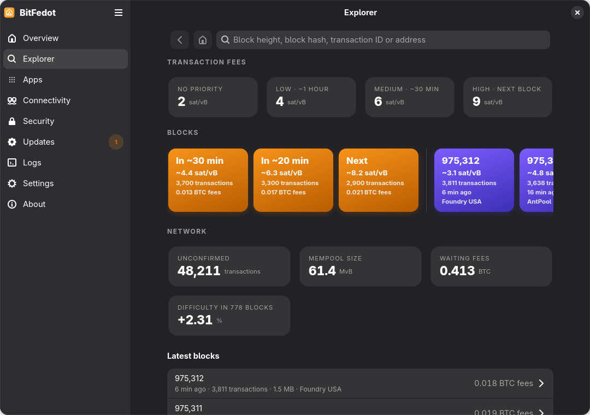
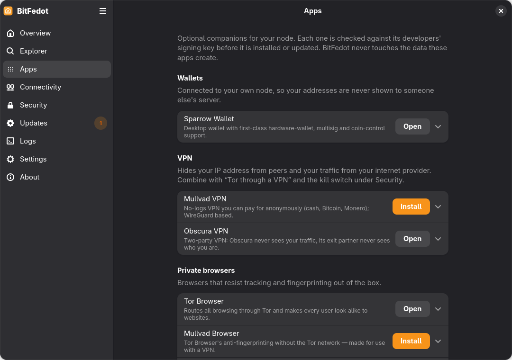
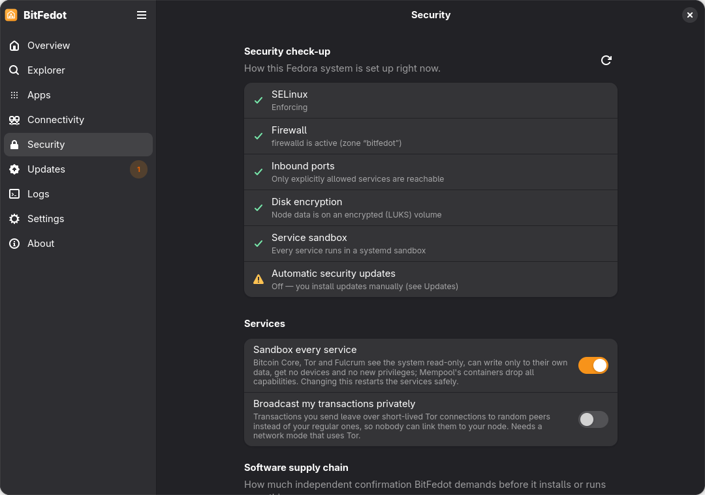
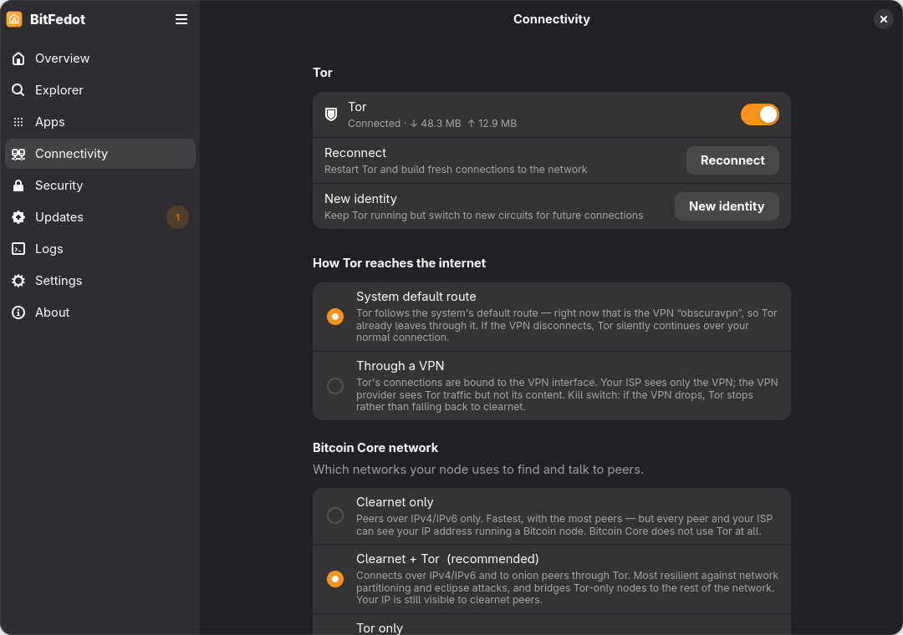
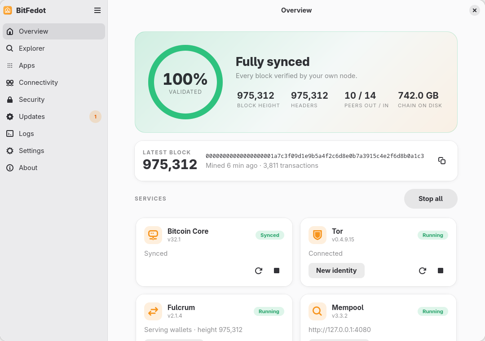
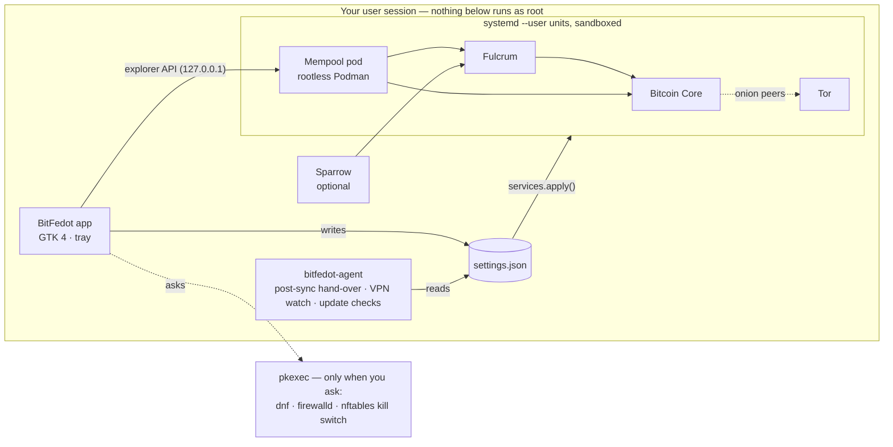

<div align="center">


# BitFedot

**A complete, private, hardened Bitcoin node for Fedora — in one native app.**

Bitcoin Core · Fulcrum · Mempool · Tor · built-in explorer · verified wallet, VPN, browser and messenger installs

[](https://github.com/G0SHA256/bitfedot/actions/workflows/ci.yml)
-blue)




*Don't trust. Verify.*

**[Website](https://g0sha256.github.io/bitfedot/)** · [Architecture](docs/ARCHITECTURE.md) · [Extending](docs/EXTENDING.md) · [Security](SECURITY.md)

</div>

BitFedot turns a Fedora machine into a full Bitcoin stack you actually control, without a
terminal. It downloads upstream releases, **verifies them against pinned developer keys**, syncs
as fast as your hardware allows, then brings up Tor, an Electrum server and a block explorer —
and keeps all of it updated, sandboxed and firewalled.

Inside it is deliberately small and boring: about 6,500 lines of Python on top of GTK 4, systemd
user services and rootless Podman. Nothing of its own runs as root, nothing phones home, and
every file it manages is generated from one settings file by one function.

> **Status — 0.2, pre-release.** Every part has been exercised against the real upstreams on
> Fedora 45 and a real node is syncing with it, but the project is young. Read
> [What has been tested](#what-has-been-tested) before trusting it with a machine you care about.

## Highlights

| | |
|---|---|
| **Guided, verified install** | Latest stable Bitcoin Core (≥ 3 builder signatures required), Fulcrum, Mempool and Tor. One password prompt, for the `tor` package. |
| **Fastest initial sync, honest estimate** | Clearnet sync tuned to the machine (UTXO cache = half your RAM, blocks-only, indexes deferred). The remaining time is estimated in *transactions*, not blocks, and allows for the slow final stretch. Tor and the other services start by themselves when it finishes. |
| **Connectivity, explained** | Clearnet · clearnet + Tor · Tor only · everything through Tor. Inbound over onion and/or public IP. Tor up/down, reconnect, new identity. Tor over the default route or **bound to a VPN**. Onion services for remote wallet access. |
| **Built-in explorer** | Native front end to *your own* Mempool API: fees, mempool, blocks, transactions, addresses. Lookups never leave the machine. |
| **Verified apps** | Optional, each checked against its developers' pinned key on install *and* update: **Sparrow** (pre-wired to your node) · **Mullvad VPN**, **Obscura VPN** · **Tor Browser**, **Mullvad Browser**, **LibreWolf** · **Element**, **SimpleX**. |
| **Fedora hardening** | Security check-up (SELinux, firewall, LUKS, Secure Boot…), systemd sandbox for every service, strict firewalld zone, system-wide **VPN kill switch** (nftables), private transaction broadcast. |
| **Hardware keys** *(experimental)* | A staged, script-by-script setup that moves disk encryption, login, sudo and release signing onto two YubiKeys, and removes the password only after both keys are proven to work. Key preparation and the signing key are proven on real YubiKeys; the disk and login stages are not yet — see [docs/HARDWARE-KEYS.md](docs/HARDWARE-KEYS.md). |
| **Safe by construction** | Any change that needs a restart stops services dependents-first and waits for clean shutdowns (Mempool → Fulcrum → Bitcoin Core → Tor), then starts them in reverse. Stop/start one or all; quitting asks: *run in background* or *shut down safely*. |
| **Updates** | Node software, apps, Fedora *and BitFedot itself*: check (through Tor when it is up), download, verify, install, restart. BitFedot installs its own update only from a release signed with the key it already carries, tests it first, and keeps the previous version for one-click rollback. |
| **Feels native** | libadwaita, light / dark / system theme, tray icon, runs in the background. |

<table>
<tr>
<td><p align="center"><sub>Explorer on your own node</sub></p></td>
<td><p align="center"><sub>Verified wallet, VPN, browser and messenger installs</sub></p></td>
</tr>
<tr>
<td><p align="center"><sub>Security check-up and hardening</sub></p></td>
<td><p align="center"><sub>Connectivity, every choice explained</sub></p></td>
</tr>
<tr>
<td><p align="center"><sub>Initial sync with a transaction-based estimate</sub></p></td>
<td><p align="center"><sub>Light theme</sub></p></td>
</tr>
</table>

## Install on Fedora

### What you need

| | Minimum | Recommended |
|---|---|---|
| **Fedora** | **Fedora 45 Workstation** | The current Fedora Workstation release, fully updated. BitFedot is developed and tested on Fedora 45 (GNOME); KDE Plasma should work but is not tested yet. Older releases are not supported: the wizard warns and they miss security fixes BitFedot counts on. |
| **CPU** | 64-bit, x86_64 or aarch64, 2 cores | 4 cores or more (verification uses all of them) |
| **RAM** | 8 GB | **16 GB or more.** Half of your RAM, up to 24 GB, is used as cache during the first sync, so more memory means a much faster sync. |
| **Storage** | **1.3 TB free** | **2 TB SSD or NVMe.** The chain grows by roughly 100 GB a year. A spinning disk works but makes the first sync take several times longer. |
| **Internet** | any broadband | unmetered — the first sync downloads about 900 GB |

Where the 1.3 TB goes: Bitcoin Core's blocks and chain state ≈ 900 GB, its transaction index
≈ 75 GB, Fulcrum's index ≈ 200 GB, Mempool's database and everything else ≈ 30 GB, plus headroom.
The wizard checks your disk and memory before it installs anything and tells you if they fall short.

Keep Fedora itself up to date first (`sudo dnf upgrade --refresh`, then reboot if a new kernel was
installed). A supported, fully patched Fedora is part of the security model.

### Install

Copy the whole block into a terminal — on GitHub, the copy button is in the top-right corner of
each block:

```sh
sudo dnf install -y git python3-gobject gobject-introspection gtk4 libadwaita curl gnupg2
git clone https://github.com/G0SHA256/bitfedot
cd bitfedot
./install.sh
```

The first line installs what BitFedot needs to start (all of it is already present on a normal
Fedora Workstation). `install.sh` puts the app into `~/.local` for your user only — it does not
use root and does not start anything.

Then open **BitFedot** from the app grid (or run `~/.local/bin/bitfedot`) and follow the wizard:
choose where the blockchain is stored, confirm, and enter your password once so Fedora's `tor`
package can be installed. Everything else — downloads, signature checks, configuration, starting
the sync — happens by itself. You can close the window; the node keeps running.

### Try it without installing anything

```sh
git clone https://github.com/G0SHA256/bitfedot && cd bitfedot
python3 -m bitfedot --demo synced
```

Demo mode shows the full interface with sample data and changes nothing on your system
(`--demo syncing` and `--theme light` are also available).

### Update

```sh
cd bitfedot && git pull && ./install.sh
```

Then close BitFedot completely and open it again — choosing *Run in background* when quitting
keeps the old version running. Your node, settings and data are untouched by an update. Once signed releases are
published, the app also updates itself from the Updates page.

### Uninstall

In the app: **Settings → Remove services** stops the node and removes its background services
(your blockchain data is kept). Then:

```sh
cd bitfedot && ./install.sh --uninstall
```

Delete `~/.local/share/bitfedot` and `~/.config/bitfedot` yourself if you also want the data gone.

An RPM spec for packagers lives in [`packaging/`](packaging/bitfedot.spec).

<details>
<summary><b>Tray icon on GNOME</b></summary>

GNOME has no system tray by default. The installer offers to add Fedora's
`gnome-shell-extension-appindicator`; the icon appears after your next login. On KDE Plasma it
works out of the box. Without a tray the app still runs in the background — launch it again to
bring the window back.
</details>

## How it works



- **One source of truth.** `~/.config/bitfedot/settings.json` → [`services.py`](bitfedot/services.py)
  renders every config file and unit. `apply()` is idempotent, ordered and locked, and is the
  only code that starts or stops anything.
- **Everything is a systemd user service.** `systemctl --user status 'bitfedot-*'` and
  `journalctl --user -u bitfedot-bitcoind` work as you would expect; the Logs page shows the same.
- **Loopback only.** Every service binds to `127.0.0.1`. The single exception is Bitcoin's P2P
  port 8333, and only if you switch on "Accept peers on your public IP".
- **No keys in the node.** Bitcoin Core runs with its wallet module disabled; your keys live in
  your wallet app (and ideally on a hardware device).
- **Root is the exception.** RPM installs, Fedora updates, the firewall zone and the kill switch
  each run as one short, input-validated `pkexec` batch that you trigger and authenticate.

More detail: [docs/ARCHITECTURE.md](docs/ARCHITECTURE.md).

## Security model

### What gets verified, and how

Every signing key is **pinned in this repository** ([`bitfedot/keys/`](bitfedot/keys), provenance
in its README) — nothing is trusted on first use. A failed check deletes the download and aborts.

| Software | Check before anything is installed or updated |
|---|---|
| Bitcoin Core | `SHA256SUMS` must carry valid signatures from **at least 3** pinned Guix builder keys; the tarball must match the signed hash. |
| Fulcrum | Checksum file signed by the pinned release key (Calin Culianu); tarball must match. |
| Sparrow | Release manifest signed by the pinned key (Craig Raw); tarball must match. |
| Tor Browser | Archive signed by the pinned Tor Browser Developers key. Afterwards it updates itself with its own signature checks. |
| Element | Element's Debian repository: signed release file → package index hash → package hash, all checked against the pinned key; unpacked per user. |
| Mullvad VPN, Mullvad Browser, Obscura VPN, LibreWolf | The vendor's RPM repository, set up with BitFedot's pinned copy of the vendor key instead of one fetched at install time; `dnf` checks every package signature. |
| SimpleX | Flatpak from Flathub, added with Flathub's pinned repository key; Flatpak verifies every download. |
| Tor, Fedora updates | RPMs from the Fedora repositories; `dnf` verifies package signatures. |
| Mempool | Upstream does not sign its container images, so BitFedot pins their **content digests** ([`pins.py`](bitfedot/pins.py)) and pulls and runs them by digest. The pins travel inside signed BitFedot releases; a Mempool version that is not pinned is refused unless you turn strict mode off. |
| BitFedot itself | Release archive must match a `SHA256SUMS` signed by the release key shipped in the running version; no downgrades; the new version must pass its own tests before it replaces anything. |

Verification runs in a throw-away GnuPG home: your own keyring is neither used nor modified.
Under Security you can raise the number of Bitcoin Core builder signatures required (3 to 8).

<details>
<summary><b>Why not build everything from source?</b></summary>

Because for the pieces that matter most it would be *weaker*, not stronger.

- **Bitcoin Core** is built reproducibly (Guix) by independent people who each sign the identical
  result. Requiring several of those signatures means several developers would have to collude or
  be compromised at once. A local compile cannot be compared with anyone else's, replaces that
  with trust in one machine's toolchain, takes an hour, and breaks more often.
- **Fulcrum, Sparrow, Tor Browser, Element**: the source archive is signed by the same key as the
  binary, so compiling it proves nothing extra unless you also audit the source.
- **Mempool** is the real gap, since its images are unsigned. Building it locally from the signed
  git tag is possible but still pulls unsigned base images and unpinned data at build time, takes
  20–30 minutes and several gigabytes, and can fail on any upstream change. Pinning the image
  digests inside signed BitFedot releases closes the same hole — a swapped image — without those
  costs. A reproducible, from-source Mempool build remains on the roadmap as an *option*.

The guiding rule: prefer several independent signatures over one build, and one pinned hash over
a mutable name. Convenience is kept by making the safe path the default one.
</details>

### Hardening you can switch on

| Option | What it does | Needs root |
|---|---|---|
| Service sandbox *(on by default)* | Bitcoin Core, Tor and Fulcrum run with a read-only view of the system, write access only to their own data, no devices, no new privileges, a restricted syscall set. Mempool's containers drop all capabilities. | no |
| Strict firewall | Moves the machine into a dedicated firewalld zone that refuses all inbound traffic. (Fedora Workstation's default zone leaves every port ≥ 1025 open.) Port 8333 opens only while you accept clearnet peers. | once |
| VPN kill switch | System-wide nftables rule set: nothing leaves except through the VPN interface. The VPN's own tunnel packets, DHCP and (optionally) the LAN stay allowed. Survives reboots. | once |
| Tor via VPN | Binds Tor to the VPN interface; if the VPN drops, Tor stops rather than falling back to clearnet. | no |
| Private broadcast | Your own transactions leave over one-shot Tor connections (`-privatebroadcast`). | no |
| Automatic security updates | Fedora's dnf5 automatic timer, security fixes only, never reboots on its own. | once |

Privacy defaults worth knowing: update checks and downloads go through Tor whenever it is up;
Fulcrum logs are anonymised; Sparrow is configured to make no third-party requests.

Found a vulnerability? Please follow [SECURITY.md](SECURITY.md).

## What has been tested

On Fedora 45 (GNOME, Wayland, SELinux enforcing), against the real upstreams:

- a complete first-run install through the wizard on real hardware, the node syncing afterwards,
  and an in-place migration of that running node between two versions of the app;
- download and signature verification of Bitcoin Core 32.1 (8 valid builder signatures),
  Fulcrum 2.1.4, Sparrow 2.5.6, Tor Browser 16.0.1 and Element 1.12.35, and rejection of
  unsigned or tampered files;
- the pinned Mullvad, Obscura and LibreWolf keys against the vendors' current RPMs (`rpmkeys`),
  and the pinned Flathub key against the live Flathub repository;
- every generated `bitcoin.conf` variant with the real `bitcoind`; the generated `torrc` with
  Fedora's Tor (bootstrap, control port, onion services, binding to a live VPN interface);
- the sandbox profile with the real `bitcoind`, `tor` and `Fulcrum` as transient user units;
- the Mempool pod (rootless, capabilities dropped) and the kill-switch rule set (loaded with
  `nft` in an unprivileged network namespace);
- the explorer client and UI against the live Mempool REST API;
- the sync-time model against the first hours of a real sync log;
- the self-updater with a throw-away signing key: signed release installed and rolled back;
  unsigned, tampered, mislabelled and older releases refused;
- 73 offline unit tests.

**Not yet verified end to end:** the post-sync hand-over on a fully synced chain; Fulcrum's
initial indexing; updates across real version bumps; everything that needs root on a live system
(RPM-based app installs, firewall zone, kill switch, Fedora updates — development had no root);
self-update against a real GitHub release (none exists yet);
the disk-encryption, login and password-removal stages of the hardware-key setup (the key
preparation and signing-key stages have been run on two real YubiKeys);
the optional apps actually *launching*; the sync estimate over a complete sync; the tray icon
under the GNOME extension and KDE. Reports are very welcome.

## Hacking on it

The code is organised so that a person or a coding assistant can pick it up quickly:
[`AGENTS.md`](AGENTS.md) is the map and the rules, [`docs/EXTENDING.md`](docs/EXTENDING.md) has
copy-paste recipes. Adding an optional app is **one data entry** in
[`bitfedot/catalog.py`](bitfedot/catalog.py).

```sh
python3 -m bitfedot --demo synced                 # UI with sample data, no node needed
python3 -m unittest discover tests                # offline tests, < 1 s
BITFEDOT_ROOT=/tmp/bf python3 -m bitfedot         # everything in a sandbox dir; systemd untouched
BITFEDOT_EXPLORER_API=https://mempool.space \
    python3 -m bitfedot --demo synced             # develop the explorer against a public API
```

| Path | What lives there |
|---|---|
| [`bitfedot/catalog.py`](bitfedot/catalog.py) | **data**: the optional apps |
| [`bitfedot/apps.py`](bitfedot/apps.py) | verified install / update / removal per delivery kind |
| [`bitfedot/services.py`](bitfedot/services.py) | config + unit rendering, ordered `apply()` |
| [`bitfedot/installer.py`](bitfedot/installer.py), [`verify.py`](bitfedot/verify.py) | core components, signature checks |
| [`bitfedot/selfupdate.py`](bitfedot/selfupdate.py), [`pins.py`](bitfedot/pins.py) | signed self-update; vouched-for image digests |
| [`bitfedot/hardening.py`](bitfedot/hardening.py) | check-up, firewall, kill switch, Fedora updates |
| [`bitfedot/eta.py`](bitfedot/eta.py) | sync time model |
| [`bitfedot/hardware_keys.py`](bitfedot/hardware_keys.py) | staged YubiKey setup (script generation, gates) |
| [`bitfedot/explorer.py`](bitfedot/explorer.py) | Mempool REST client |
| [`bitfedot/node.py`](bitfedot/node.py), [`agent.py`](bitfedot/agent.py) | status snapshot, actions, background agent |
| [`bitfedot/ui/`](bitfedot/ui) | one module per page; no business logic |

House rules in one line: no new runtime dependencies, nothing runs before it is verified, nothing
runs as root unless the user asked, UI code stays free of logic. See [CONTRIBUTING.md](CONTRIBUTING.md).

## Roadmap

- I2P and CJDNS as additional Bitcoin Core networks
- Optional reproducible build of Mempool from its signed tag; run Mempool without internet access
  (today it needs GitHub for mining-pool data at first start)
- Tor's SOCKS port on a Unix socket, so other local programs cannot use it
- polkit policy + helper for the RPM build (replace ad-hoc `pkexec` batches)
- Lightning (Core Lightning or LND) as an optional service
- Backup/restore of onion keys and settings; relocating the data directory
- More verified apps; COPR repository; translations

## Thank you

To **Satoshi Nakamoto**, first — the [whitepaper](bitfedot/data/docs/bitcoin.pdf) ships with the
app and can be saved from its About page. And to every project BitFedot installs, runs or is built
on: Bitcoin Core, Fulcrum, Mempool, Tor, Sparrow, Mullvad, Obscura, LibreWolf, Element, SimpleX,
Fedora, GNOME, systemd, Podman, GnuPG, curl and more. The full list is in [THANKS.md](THANKS.md).

## Author and license

Made by [**G0SHA256**](https://github.com/G0SHA256).

BitFedot is released into the **public domain** under [The Unlicense](LICENSE): copy it, change
it, sell it, ship it inside something else — no permission, attribution or conditions.

The software it installs keeps its own licences and is downloaded from its authors, not
redistributed here. The bundled public keys belong to their owners; the bundled Bitcoin
whitepaper is under the MIT licence. BitFedot is an independent project, not affiliated with or
endorsed by the Fedora Project, Red Hat, or any project named above. "Fedora" is a trademark of
Red Hat, Inc.
